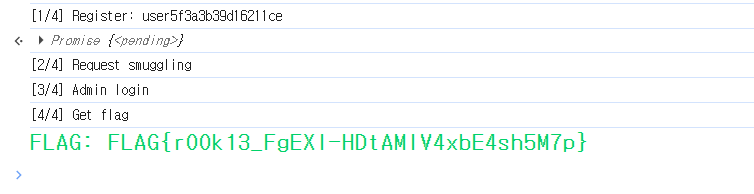

# Login System 발표 대본

* **예상 발표 시간:** 5~7분
* **핵심 취약점:** TE.TE HTTP Request Smuggling, JSON Injection, Broken Access Control
* **관련 문서:** [Login System Write-up](Login%20System.md)

---

## 1. 도입

안녕하세요. 이번에 설명할 문제는 Web 분야의 **Login System**입니다.

이 문제의 목표는 일반 사용자로 시작해서 관리자 권한을 얻고, 최종적으로 `/flag` 엔드포인트에 접근하는 것입니다.

핵심은 취약점 하나만 사용하는 것이 아니라 다음 두 가지 취약점을 연결하는 것입니다.

첫 번째는 **HTTP Request Smuggling**, 두 번째는 **Nim JSON 라이브러리의 RawNumber 특성을 이용한 JSON Injection**입니다.

공격 흐름을 먼저 간단하게 말하면 다음과 같습니다.

```text
Request Smuggling으로 비밀번호 변경 기능에 접근
                         ↓
JSON Injection으로 privilegeLevel을 admin으로 변경
                         ↓
관리자 로그인 후 /flag 접근
```

---

## 2. 서비스 구조

이 문제는 서버가 하나가 아니라 두 개로 구성되어 있습니다.

```text
브라우저
   ↓
Node.js Express 서버
   ↓
Nim 로그인 서버
```

앞에 있는 Node.js 서버는 세션과 권한 검사를 담당합니다. 뒤에 있는 Nim 서버는 회원가입, 로그인, 비밀번호 변경, 사용자 파일 저장을 담당합니다.

Node.js 서버는 사용자의 권한에 따라 YAML 파일을 불러옵니다. guest는 회원가입과 로그인만 할 수 있고, admin만 비밀번호 변경과 `/flag` 접근 권한을 가지고 있습니다.

따라서 guest 상태에서 `/change_password`에 정상적으로 요청하면 Node.js의 권한 검사에서 403 응답을 받습니다.

여기까지만 보면 관리자 권한을 얻을 수 없어 보이지만, Node.js와 Nim이 HTTP 요청을 서로 다르게 해석한다는 문제가 있습니다.

---

## 3. 첫 번째 취약점 - HTTP Request Smuggling

Request Smuggling에서 Smuggling은 우리말로 **밀수**라는 뜻입니다.

택배에 비유하면 앞쪽 검문소는 택배 상자가 하나라고 판단했지만, 뒤쪽 창고는 상자 안에 숨겨진 두 번째 배송장을 발견하고 추가 작업까지 처리하는 상황입니다.

이 문제에서는 다음 헤더를 이용합니다.

```http
Transfer-Encoding: CHUNKED
```

Node.js는 HTTP 헤더 값을 대소문자 구분 없이 처리하므로 대문자 `CHUNKED`도 정상적인 Chunked Encoding으로 인식합니다.

하지만 Nim 1.6.14의 HTTP 서버는 소문자 `chunked`와 정확하게 일치하는지를 확인합니다. 따라서 대문자 `CHUNKED`를 Chunked Encoding으로 인식하지 못합니다.

정리하면 같은 요청을 다음처럼 다르게 해석합니다.

```text
Node.js: CHUNKED를 정상적인 Chunked Body로 처리
Nim:     CHUNKED를 인식하지 못함
```

이 차이를 이용해 `/login` 요청의 본문 안에 다음 요청을 숨깁니다.

```http
POST /change_password HTTP/1.0
Content-Length: ...
Content-Type: application/json

{비밀번호 변경 데이터}
```

Node.js가 보기에는 이것이 `/login` 요청의 본문입니다. 따라서 guest도 사용할 수 있는 `/login` 권한만 검사합니다.

반면 Nim은 본문 안의 `POST /change_password`를 새로운 두 번째 HTTP 요청으로 인식하여 실행합니다.

결과적으로 Node.js의 관리자 권한 검사를 거치지 않고 Nim 서버의 비밀번호 변경 기능을 사용할 수 있습니다.

이 유형은 양쪽 서버가 모두 `Transfer-Encoding`을 기준으로 처리하지만 해석 방식이 다르기 때문에 **TE.TE HTTP Request Smuggling**이라고 부릅니다.

여기서 `/_raw` 엔드포인트는 브라우저에서 원시 HTTP 요청을 전달하기 위해 사용했습니다. 브라우저의 `fetch()`는 `Transfer-Encoding` 같은 헤더를 직접 설정하지 못하므로, 전체 HTTP 요청을 문자열로 만든 뒤 `/_raw`에 전달했습니다.

---

## 4. 두 번째 취약점 - RawNumber JSON Injection

Request Smuggling을 통해 비밀번호를 변경할 수 있게 되었지만, 비밀번호만 바꿔서는 관리자 권한을 얻을 수 없습니다.

회원가입 코드에서는 `privilegeLevel`이 반드시 `user`인지 검사합니다.

```nim
if privilegeLevel != "user":
  errorJSON "privilegeLevel must be user"
```

따라서 처음부터 `admin` 계정을 등록하는 방식은 사용할 수 없습니다.

여기서 Nim JSON 라이브러리의 큰 숫자 처리 방식을 이용합니다.

회원가입할 때 비밀번호를 문자열이 아닌 매우 큰 숫자로 전달합니다.

```json
{
  "privilegeLevel": "user",
  "username": "user12345678",
  "password": 1111111111111111111111111111111
}
```

이 숫자는 Nim 정수 범위를 초과하기 때문에 `RawNumber`라는 형태로 저장됩니다. 내부적으로는 문자열과 비슷하지만, JSON으로 다시 저장할 때 따옴표를 붙이지 않는 상태를 가지고 있습니다.

비밀번호 변경 코드는 새로운 JSON 문자열을 만드는 것이 아니라 기존 노드의 `.str` 값만 변경합니다.

```nim
user["password"].str = newPassword
```

문자열 내용은 바뀌지만 RawNumber의 따옴표 없이 출력되는 속성은 그대로 남습니다.

그래서 새로운 비밀번호로 다음 값을 전달합니다.

```text
"peko","privilegeLevel":"admin"
```

사용자 파일을 다시 저장하면 다음과 같은 JSON 구조가 만들어집니다.

```json
{
  "privilegeLevel": "user",
  "username": "user12345678",
  "password": "peko",
  "privilegeLevel": "admin"
}
```

원래 비밀번호가 들어가야 할 위치에 새로운 JSON 속성이 삽입된 것입니다. 이것을 **JSON Injection**이라고 합니다.

`privilegeLevel`이 두 번 존재하지만 JSON 파서는 마지막에 있는 `admin` 값을 사용합니다. 따라서 이 계정으로 로그인하면 Node.js 세션의 권한도 `admin`으로 설정됩니다.

---

## 5. 실제 공격 순서

실제 PoC는 브라우저 개발자 도구의 Console에서 실행했습니다.

첫 번째 단계에서는 큰 숫자를 비밀번호로 사용하여 일반 사용자 계정을 등록합니다.

두 번째 단계에서는 `Transfer-Encoding: CHUNKED`를 사용한 요청 안에 `/change_password` 요청을 숨겨 Nim 서버로 전달합니다.

세 번째 단계에서는 JSON Injection으로 만들어진 비밀번호 `peko`를 이용해 다시 로그인합니다. 로그인 응답의 `privilegeLevel`이 `admin`이므로 관리자 세션이 생성됩니다.

마지막 단계에서는 관리자 세션으로 `/flag`에 접근합니다.

```text
[1/4] Register
[2/4] Request smuggling
[3/4] Admin login
[4/4] Get flag
```

콘솔 실행 결과 모든 단계가 정상적으로 처리되었고, 최종적으로 FLAG가 출력되었습니다.



---

## 6. 취약점이 발생한 근본 원인

첫 번째 원인은 Node.js와 Nim이 HTTP 요청의 경계를 다르게 판단한 것입니다. 프록시와 백엔드가 동일한 요청을 다르게 해석하면 Request Smuggling이 발생할 수 있습니다.

두 번째 원인은 실제 비밀번호 변경 기능을 수행하는 Nim 서버에 별도의 권한 검사가 없다는 것입니다. 앞쪽 Node.js가 검사할 것이라고 가정했지만, 프록시 계층이 우회되면서 보호가 사라졌습니다.

세 번째 원인은 비밀번호가 문자열 타입인지 확인하지 않았다는 것입니다. 이 때문에 큰 숫자를 RawNumber로 입력할 수 있었습니다.

마지막으로 기존 JSON 노드의 문자열 값만 직접 수정하면서 RawNumber의 내부 상태가 유지된 것도 문제였습니다.

---

## 7. 대응 방안

먼저 프록시와 백엔드가 동일한 HTTP 파싱 규칙을 사용해야 합니다. 모호하거나 비표준적인 `Transfer-Encoding` 값은 앞단에서 거부해야 합니다.

두 번째로 `/change_password`와 같은 민감한 기능은 Nim 서버에서도 인증과 권한을 다시 검사해야 합니다. 내부 서버로 전달된 요청이라고 해서 무조건 신뢰하면 안 됩니다.

세 번째로 회원가입과 비밀번호 변경 시 비밀번호 필드가 실제 JSON 문자열인지 확인해야 합니다.

마지막으로 기존 노드의 `.str` 값만 수정하지 말고 다음과 같이 새로운 문자열 노드를 만들어 교체해야 합니다.

```nim
user["password"] = %newPassword
```

중복된 `privilegeLevel` 키가 포함된 JSON도 파싱 단계에서 거부하는 것이 안전합니다.

---

## 8. 마무리

이 문제는 서로 다른 서버와 라이브러리의 작은 해석 차이가 연결되면 큰 권한 상승으로 이어질 수 있다는 점을 보여줍니다.

취약점 명칭을 다시 정리하면 다음과 같습니다.

```text
1. TE.TE HTTP Request Smuggling
2. Broken Access Control
3. Nim RawNumber 기반 JSON Injection
4. Privilege Escalation
```

최종적으로 Request Smuggling을 이용해 보호된 비밀번호 변경 기능을 실행하고, JSON Injection을 통해 사용자 권한을 `admin`으로 변경하여 FLAG를 획득했습니다.

이상으로 발표를 마치겠습니다.

---

## 9. 예상 질문

### Q1. 왜 `CHUNKED`를 대문자로 사용했나요?

Node.js는 대소문자를 구분하지 않아 정상 처리하지만, Nim은 소문자 `chunked`와 정확히 일치하는지만 검사하기 때문입니다. 이 해석 차이를 만들기 위해 대문자를 사용했습니다.

### Q2. 왜 Request Smuggling이 필요한가요?

guest는 Node.js의 권한 검사 때문에 `/change_password`에 직접 접근할 수 없습니다. 본문에 요청을 숨기면 Node.js는 `/login`만 검사하고 Nim이 숨겨진 `/change_password`를 실행합니다.

### Q3. 왜 비밀번호로 큰 숫자를 사용하나요?

Nim이 일반 정수로 처리할 수 없는 숫자를 `RawNumber`로 만들기 위해서입니다. RawNumber는 값을 수정한 뒤에도 따옴표 없이 직렬화되는 상태가 유지됩니다.

### Q4. `privilegeLevel`이 두 개여도 문제가 없나요?

JSON 표준에서는 중복 키의 처리 결과가 구현에 따라 달라질 수 있습니다. 이 문제의 Nim JSON 파서는 뒤쪽 값을 사용하므로 마지막에 삽입한 `admin`이 적용됩니다.

### Q5. `/_raw` 자체가 Request Smuggling 취약점인가요?

`/_raw`는 브라우저에서 원시 HTTP 요청을 전송하기 위한 통로입니다. 실제 Smuggling 취약점의 핵심은 Node.js와 Nim이 `Transfer-Encoding: CHUNKED`를 다르게 해석하는 부분입니다.
