# DEADFACE CTF 풀이 기록 — 초보자용 단계별 설명

이 문서는 CTF와 SQL을 처음 접하는 사람도 풀이를 따라갈 수 있도록 작성했습니다. Aurora Health 데이터베이스 문제 4개와 PCAP 네트워크 분석 문제 1개를 다룹니다. **실제로 풀이를 완료한 문제만** 포함했습니다.

> CTF의 flag는 정답을 제출할 때 쓰는 문자열입니다. 문제에서 지정한 형식이 있다면 괄호 안의 값까지 맞춰 제출해야 합니다. 예를 들어 `deadface{AH-1234567}` 형식이라면 중괄호를 포함해 입력합니다.

## 목차

1. [시작하기: SQL 셸에서 알아둘 것](#시작하기-sql-셸에서-알아둘-것)
2. [환자 레지스트리의 VIP 기록](#환자-레지스트리의-vip-기록)
3. [Schedule of Concern](#schedule-of-concern)
4. [After the Lock](#after-the-lock)
5. [Ghost in the Registry](#ghost-in-the-registry)
6. [Bad Guys Be Bad](#bad-guys-be-bad)

---

## 시작하기: SQL 셸에서 알아둘 것

데이터베이스 문제에서는 제공된 SQL 셸에 접속해 표 형태의 데이터를 조회합니다. 이번 문제 환경은 MySQL/MariaDB 문법을 사용했습니다. 명령 끝에 세미콜론(`;`)을 붙여야 실행됩니다.

```sql
SHOW DATABASES;
```

셸에 명령을 입력하면 `;`가 나올 때까지 문장을 입력받고, 실행 결과를 출력합니다. 여러 줄로 나눠 입력해도 마지막에 세미콜론을 입력하면 실행됩니다.

### 데이터베이스, 테이블, 컬럼

- **데이터베이스(database)**: 관련된 테이블을 모아 둔 공간입니다. 예: `aurora_ehr`, `aurora_pharmacy`.
- **테이블(table)**: 실제 데이터가 행과 열로 저장된 표입니다. 예: `patients`, `drugs`.
- **컬럼(column)**: 표의 각 항목입니다. 환자 테이블에는 `mrn`, `patient_id` 같은 컬럼이 있을 수 있습니다.
- **행(row)**: 한 환자나 약물처럼 표에 저장된 개별 레코드입니다.

처음에는 어떤 DB와 테이블이 있는지 확인합니다.

```sql
SHOW DATABASES;
USE aurora_ehr;
SHOW TABLES;
DESCRIBE patients;
```

`USE`는 이후의 짧은 테이블 이름이 어느 데이터베이스를 가리키는지 선택합니다. `DESCRIBE`는 테이블의 컬럼 이름과 자료형을 보여 줍니다. 다른 데이터베이스의 테이블은 `aurora_pharmacy.drugs`처럼 `데이터베이스.테이블` 형식으로 직접 지정할 수도 있습니다.

### 오류가 났을 때 확인할 점

- `Unknown column` 오류는 컬럼 이름을 잘못 썼거나 해당 테이블에 그 컬럼이 없다는 뜻입니다. 철자와 `DESCRIBE 테이블명;` 결과를 확인합니다.
- 조회 결과가 비어 있으면 조건이 틀렸는지, 현재 선택한 데이터베이스가 맞는지 확인합니다.
- SQL 문장이 계속 `->` 프롬프트로 이어지면 아직 세미콜론을 입력하지 않았을 수 있습니다. 입력을 취소하려면 MySQL 셸에서 `\c`를 사용할 수 있습니다.

---

## 환자 레지스트리의 VIP 기록

### 문제에서 요구한 것

유출된 Aurora Health 환자 데이터에서 가명으로 등록된 VIP 환자를 찾고 **실제 MRN(Medical Record Number)** 을 제출합니다. MRN은 의료 기록을 식별하는 번호입니다.

### 1단계: 환자 데이터베이스 찾기

환자 정보가 어느 데이터베이스에 있는지 확인합니다.

```sql
SHOW DATABASES;
```

목록에서 EHR(전자 건강 기록) 데이터베이스인 `aurora_ehr`를 선택하고, 환자 테이블이 있는지 확인합니다. 앞서 `DATABASE()`가 `NULL`을 반환했다면 아직 기본 데이터베이스가 선택되지 않은 상태입니다. 그래도 `INFORMATION_SCHEMA`에서 전체 스키마를 조회해 테이블이 어디에 있는지 찾을 수 있습니다.

```sql
SELECT TABLE_SCHEMA, TABLE_NAME
FROM INFORMATION_SCHEMA.TABLES
WHERE TABLE_NAME LIKE '%patient%';
```

조회 결과에서 `patients`가 `aurora_ehr`에 있다는 것을 확인합니다. 그런 다음 해당 DB를 선택해 테이블 구조를 확인합니다.

```sql
USE aurora_ehr;
SHOW TABLES;
DESCRIBE patients;
```

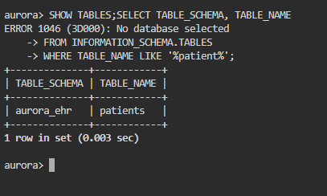

이 이미지에서는 기본 DB가 선택되지 않았을 때 `SHOW TABLES`가 오류를 낸 뒤, 정보 스키마 조회를 통해 `aurora_ehr.patients`를 찾아낸 과정을 볼 수 있습니다.

처음 시도에서 `INFORMATION_SCHEMA.COLUMNS`를 조회하다가 컬럼 이름 오타로 오류가 날 수 있습니다. 정확한 이름은 `COLUMN_NAME`입니다. 그리고 `TABLE_SCHEMA = DATABASE()` 조건은 현재 선택한 데이터베이스만 검색하므로, DB를 선택하지 않았거나 다른 DB에 있으면 결과가 비어 있을 수 있습니다. 초보자라면 우선 `SHOW TABLES`와 `DESCRIBE`로 직접 확인하는 편이 간단합니다.

### 2단계: VIP 환자만 필터링

문제의 단서는 직원이 레코드를 VIP로 표시했다는 점입니다. `patients`에서 VIP 여부 컬럼인 `is_vip`를 확인하고, 삭제되지 않은 행만 남깁니다.

```sql
SELECT alias, mrn
FROM patients
WHERE is_vip = 1
  AND deleted_at IS NULL;
```

각 부분은 다음 의미입니다.

- `SELECT alias, mrn`: 결과에 가명과 MRN 두 컬럼을 표시합니다.
- `FROM patients`: 환자 테이블에서 조회합니다.
- `WHERE is_vip = 1`: VIP 표시가 켜진 행만 선택합니다.
- `AND deleted_at IS NULL`: 삭제 날짜가 비어 있는, 즉 삭제 처리되지 않은 레코드만 선택합니다.

`NULL`은 SQL에서 값이 없음을 뜻합니다. 값이 비어 있는지 검사할 때 `= NULL`이 아니라 `IS NULL`을 씁니다. 아래 캡처는 `patients` 컬럼을 확인해 `mrn`, `alias`, `is_vip`, `deleted_at`을 식별한 뒤 조회한 화면입니다.

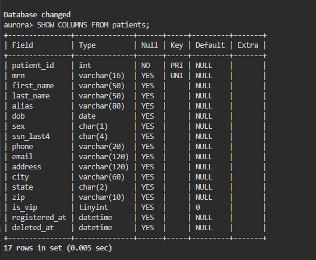

### 3단계: 결과에서 답 고르기

결과에서 alias는 `George Harmon`, MRN은 `AH-0044719`였습니다. 문제는 alias 자체가 아니라 **MRN**을 요구하므로 MRN을 flag에 넣습니다.

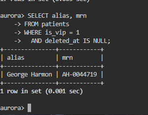

**제출값:** `deadface{AH-0044719}`

---

## Schedule of Concern

### 문제에서 요구한 것

약품 목록에서 DEA Schedule II로 분류된 약물이 몇 개인지 셉니다. 여기서 요구하는 것은 처방 건수나 환자 수가 아니라 `drugs` 테이블에 등록된 약품 행의 개수입니다.

DEA Schedule은 미국 규제 약물 분류입니다. 이 문제에서는 데이터의 `dea_schedule` 컬럼에 저장된 등급 중 `II`를 세면 됩니다.

### 1단계: 약품 테이블 확인

약국 데이터가 있는 데이터베이스를 선택하고 테이블 구조를 확인합니다.

```sql
USE aurora_pharmacy;
SHOW TABLES;
DESCRIBE drugs;
```

`DESCRIBE` 결과에서 약품의 규제 등급을 담는 컬럼이 `dea_schedule`인지 확인합니다.

### 2단계: Schedule II 행 개수 세기

```sql
SELECT COUNT(*) AS schedule_ii_count
FROM drugs
WHERE dea_schedule = 'II';
```

- `WHERE dea_schedule = 'II'`는 등급이 `II`인 약품만 남깁니다.
- `COUNT(*)`는 남은 행의 개수를 계산합니다.
- `AS schedule_ii_count`는 출력 컬럼에 읽기 쉬운 이름을 붙입니다. `AS` 뒤의 이름은 결과를 이해하기 위한 별칭이며, 테이블을 수정하지 않습니다.

### 3단계: 숫자를 flag로 제출

결과는 `9`였습니다. 개수 문제에서는 출력된 숫자를 그대로 문제의 flag 형식에 넣으면 됩니다.

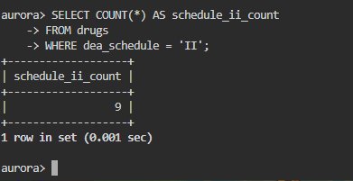

**제출값:** `deadface{9}`

---

## After the Lock

### 문제에서 요구한 것

Veltrexa 임상시험에서 주요 효능 결과(`primary_efficacy_delta`)가 공식 데이터 잠금일(data-lock date) 이후에 수정된 피험자를 찾습니다. 최종 답은 피험자의 코드입니다.

데이터 잠금일은 분석을 위해 임상시험 데이터를 확정한 날짜라고 보면 됩니다. 그 날짜가 지난 뒤 값이 수정되었다면 문제에서 찾는 이상 기록입니다.

### 1단계: 필요한 정보가 어느 표에 있는지 파악

문제에 필요한 값은 세 종류입니다.

| 필요한 정보 | 테이블 | 사용할 컬럼 |
|---|---|---|
| 연구 약물과 데이터 잠금일 | `studies` | `drug_name`, `data_lock_date`, `study_id` |
| 피험자 코드와 연구 ID | `subjects` | `subject_code`, `study_id`, `subject_id` |
| 측정 항목과 수정 시각 | `results` | `subject_id`, `measure`, `modified_at` |

테이블이 확실하지 않다면 다음 명령으로 확인할 수 있습니다.

```sql
USE aurora_trials;
SHOW TABLES;
DESCRIBE studies;
DESCRIBE subjects;
DESCRIBE results;
```

테이블 목록에서 `studies`, `subjects`, `results`가 있는 것을 확인합니다.

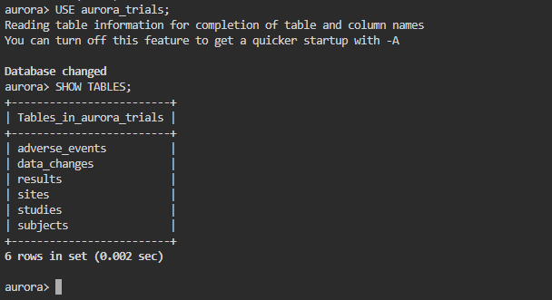

컬럼 구조를 보면 `studies.study_id`와 `subjects.study_id`가 연구와 피험자를 연결하고, `subjects.subject_id`와 `results.subject_id`가 피험자와 측정 결과를 연결한다는 것을 알 수 있습니다. 또한 잠금일은 `studies.data_lock_date`, 효능 항목은 `results.measure`, 수정 시각은 `results.modified_at`에 저장됩니다.

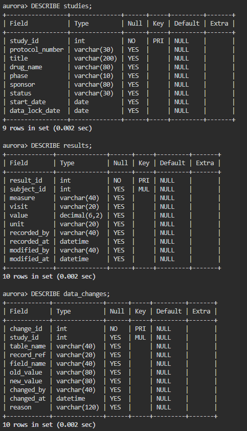

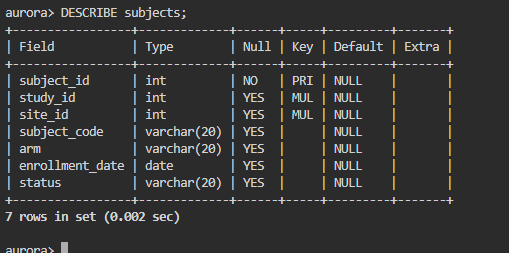

### 2단계: 세 테이블을 연결

SQL의 `JOIN`은 공통 식별자 값이 같은 행을 이어 붙이는 기능입니다. 연구 ID로 연구와 피험자를 연결하고, 피험자 ID로 피험자와 결과를 연결합니다.

```sql
SELECT su.subject_code,
       st.data_lock_date,
       r.measure,
       r.modified_at
FROM studies AS st
JOIN subjects AS su
  ON su.study_id = st.study_id
JOIN results AS r
  ON r.subject_id = su.subject_id
WHERE st.drug_name LIKE '%Veltrexa%'
  AND r.measure = 'primary_efficacy_delta'
  AND DATE(r.modified_at) > st.data_lock_date
ORDER BY r.modified_at;
```

### 3단계: 조건을 하나씩 읽기

- `FROM studies AS st`: `studies`를 조회 시작점으로 삼고, 짧게 `st`라고 부릅니다. 테이블 별칭은 긴 이름을 반복하지 않게 해 줍니다.
- 첫 번째 `JOIN`: `study_id`가 같은 연구와 피험자를 붙입니다.
- 두 번째 `JOIN`: `subject_id`가 같은 피험자와 측정 결과를 붙입니다.
- `LIKE '%Veltrexa%'`: 약물명에 `Veltrexa`가 들어간 연구를 찾습니다. `%`는 앞이나 뒤에 다른 글자가 있어도 된다는 와일드카드입니다.
- `r.measure = 'primary_efficacy_delta'`: 문제에서 지정한 주요 효능 측정값만 남깁니다.
- `DATE(r.modified_at) > st.data_lock_date`: 수정 시각에서 날짜 부분만 꺼내 잠금 날짜보다 **큰** 경우를 선택합니다. `>`를 사용하므로 잠금 날짜와 같은 날은 포함되지 않습니다.
- `ORDER BY r.modified_at`: 수정 시각 순으로 결과를 정렬합니다. 결과가 여러 건일 때 확인하기 쉽습니다.

### 4단계: 수정 시각과 잠금일 비교

결과의 데이터 잠금일은 `2025-12-01`, 수정된 결과의 시각은 `2025-12-06 23:14`였습니다. 12월 6일은 12월 1일보다 뒤이므로 조건을 만족합니다. 해당 행의 subject code는 `VELT-0137`입니다.

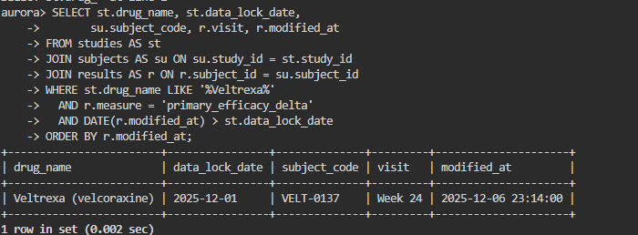

**제출값:** `deadface{VELT-0137}`

---

## Ghost in the Registry

### 문제에서 요구한 것

문제의 가설은 “실제로 진료를 받은 적은 없지만 Schedule II 약을 처방받은 가짜 환자가 있다”는 것입니다. 환자 정보는 EHR에, 처방과 약품 정보는 약국 데이터베이스에 있습니다. 두 시스템은 공통 `patient_id`를 사용하므로 그 값을 기준으로 연결해 가짜 환자의 MRN을 찾습니다.

### 1단계: 문제 조건을 데이터 조건으로 바꾸기

문장을 두 가지 조건으로 나눕니다.

1. Schedule II 약품 처방이 적어도 한 건 존재한다.
2. 해당 환자의 EHR encounter(진료 기록)는 한 건도 존재하지 않는다.

첫째 조건은 처방과 약품을 연결한 뒤 `dea_schedule = 'II'`로 필터링합니다. 둘째 조건은 `encounters` 테이블에서 환자 ID가 발견되지 않아야 한다는 뜻입니다.

### 2단계: 관련 테이블과 연결 키 확인

먼저 각 DB에 어떤 테이블이 있고, 테이블 간에 어떤 ID를 공유하는지 확인합니다.

```sql
USE aurora_pharmacy;
SHOW TABLES;
DESCRIBE prescriptions;
DESCRIBE drugs;

USE aurora_ehr;
SHOW TABLES;
DESCRIBE patients;
DESCRIBE encounters;
```

약국 테이블에서는 `prescriptions.patient_id`, `prescriptions.drug_id`, `drugs.drug_id`, `drugs.dea_schedule`을 확인합니다. EHR 테이블에서는 `patients.patient_id`, `patients.mrn`, `encounters.patient_id`를 확인합니다. `patient_id`는 두 시스템에서 공통으로 쓰이고 `drug_id`는 처방과 약품을 연결합니다.

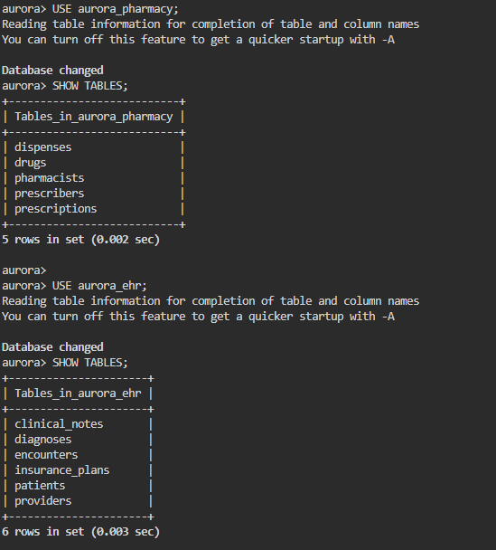

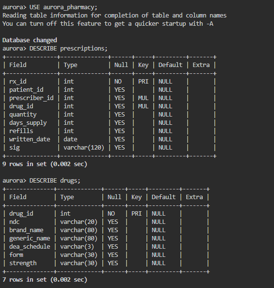

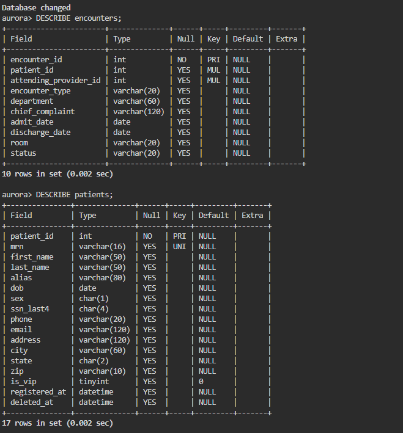

### 3단계: 서로 다른 DB의 테이블 연결

DB를 별도로 선택하는 대신 테이블 이름에 데이터베이스 이름을 붙여 사용할 수 있습니다. 예를 들어 `aurora_ehr.patients`는 `aurora_ehr` DB 안의 `patients` 테이블입니다.

```sql
SELECT DISTINCT p.patient_id,
       p.mrn
FROM aurora_ehr.patients AS p
JOIN aurora_pharmacy.prescriptions AS rx
  ON rx.patient_id = p.patient_id
JOIN aurora_pharmacy.drugs AS d
  ON d.drug_id = rx.drug_id
WHERE d.dea_schedule = 'II'
  AND NOT EXISTS (
    SELECT 1
    FROM aurora_ehr.encounters AS e
    WHERE e.patient_id = p.patient_id
  );
```

약품 등급으로 `II`가 실제 데이터에서 사용되는지도 살펴볼 수 있습니다. 아래 조회는 `drugs`에 존재하는 서로 다른 DEA 분류를 보여 줍니다. 이 확인은 후속 분석에서 Schedule II 조건을 이해하는 데 도움이 됩니다.

```sql
SELECT DISTINCT dea_schedule
FROM aurora_pharmacy.drugs
ORDER BY dea_schedule;
```

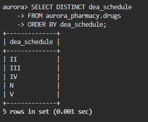

### 4단계: 조인과 `NOT EXISTS` 이해하기

- `patients`와 `prescriptions`는 `patient_id`가 같은 행끼리 연결됩니다.
- `prescriptions`와 `drugs`는 `drug_id`가 같은 행끼리 연결됩니다. 처방만 보면 약의 규제 등급을 알 수 없으므로 약품 테이블도 필요합니다.
- `d.dea_schedule = 'II'`는 연결된 약품이 Schedule II일 때만 남깁니다.
- `NOT EXISTS (...)`는 괄호 안의 조회 결과가 **없을 때** 참입니다. 안쪽 쿼리는 현재 환자의 `patient_id`로 encounter를 찾으므로, 기록이 한 건이라도 있으면 해당 환자는 제외됩니다.
- `DISTINCT`는 한 환자가 Schedule II 처방을 여러 건 받았을 때 결과가 중복되는 것을 막습니다.

### 5단계: 결과에서 MRN 선택

결과에 남은 환자의 `patient_id`는 `1060`, MRN은 `AH-0090001`이었습니다. `patient_id`는 여러 시스템을 연결하는 내부 키이며, 문제에서 제출하라고 한 값은 MRN입니다.

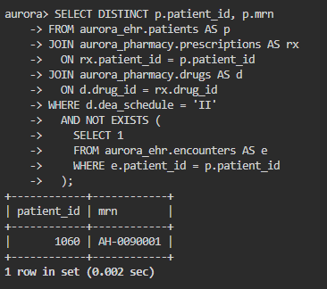

**제출값:** `deadface{AH-0090001}`

---

## Bad Guys Be Bad

### 문제에서 요구한 것

PCAP은 네트워크 통신을 저장한 파일입니다. 이 문제에서는 캡처 안의 HTTP와 DNS 통신을 따라가 외부로 전송된 데이터를 복원하고, 그 안의 flag를 찾습니다.

용어를 간단히 정리하면 다음과 같습니다.

- **PCAP**: 패킷 캡처 파일. Wireshark 같은 분석 도구로 열어볼 수 있습니다.
- **C2(Command and Control)**: 공격자가 감염된 시스템과 통신하는 제어 서버 또는 통신 경로입니다.
- **Exfiltration(유출)**: 내부의 데이터를 외부로 보내는 행위입니다.
- **DNS 터널링**: DNS 조회 이름에 데이터를 넣어 전송하는 방식입니다.

### 1단계: PCAP을 열고 HTTP 트래픽 찾기

Wireshark에서 제공된 캡처 파일을 엽니다. 표시 필터에 `http`를 입력하면 HTTP 패킷만 볼 수 있습니다. 특정 포트가 의심되면 `tcp.port == 8080`으로 범위를 좁힙니다.

문제에서는 `45.13.37.7:8080`으로 향하는 통신 중 `/staging.bin` 요청이 단서입니다. 요청 패킷을 선택한 뒤 응답 패킷의 내용을 살펴봅니다. Wireshark에서는 패킷 우클릭 후 **Follow → TCP Stream**을 선택하면 요청과 응답의 대화를 텍스트로 이어서 보기 편합니다.

HTTP 응답에서 다음 설정을 확인했습니다.

```text
channel=dns
xor_key=Sp00ky
target=exfil.deadface-c2.net
```

이 설정은 이후 분석 방향을 알려 줍니다.

- `channel=dns`: 데이터 조각이 DNS 요청에 있을 가능성이 큽니다.
- `xor_key=Sp00ky`: 조각을 디코딩한 다음 XOR 키로 사용합니다.
- `target=...`: DNS 트래픽에서 따라가야 할 도메인입니다.

### 2단계: DNS 패킷에서 조각 수집

Wireshark 표시 필터에 다음을 입력해 DNS 패킷을 확인합니다.

```text
dns
```

목적지 도메인이 포함된 조회만 좁혀 보려면 다음 필터를 사용할 수 있습니다.

```text
dns.qry.name contains "exfil.deadface-c2.net"
```

DNS 쿼리 이름에 인코딩 데이터가 도메인 앞부분으로 나뉘어 들어 있습니다. 문제의 트래픽 순서대로 데이터 부분을 모으면 다음 조각을 얻습니다.

```text
G4KVCVANDAYB
KS2TLETCOASR
KYGRAMBPKJKT
IGZGANBVSBI6
FY
```

조각 사이의 줄바꿈은 읽기 편하게 표시한 것일 뿐, 복원할 때는 공백 없이 순서대로 이어 붙입니다.

```text
G4KVCVANDAYBKS2TLETCOASRKYGRAMBPKJKTIGZGANBVSBI6FY
```

### 3단계: Base32로 원래 바이트 복구

DNS 이름에 실린 문자열은 Base32로 인코딩되어 있습니다. Base32는 임의의 바이트 데이터를 영문 대문자와 숫자 `2`부터 `7`까지의 문자로 표현하는 인코딩 방식입니다. 이는 암호화가 아니므로 Base32 디코딩만으로 평문이 나오지 않을 수 있습니다.

### 4단계: XOR 키로 복호화

응답 설정에서 찾은 `Sp00ky`를 반복 키로 사용합니다. XOR는 두 바이트를 비교해 같은 비트는 0, 다른 비트는 1로 만드는 연산입니다. 같은 키로 다시 XOR하면 원래 값이 복구됩니다. 이 문제에서는 키 문자를 데이터 길이만큼 반복 적용합니다.

아래 코드는 조각 연결, Base32 디코딩, 반복 키 XOR를 한 번에 수행합니다.

```python
import base64

chunks = (
    "G4KVCVANDAYB"
    "KS2TLETCOASR"
    "KYGRAMBPKJKT"
    "IGZGANBVSBI6"
    "FY"
)

# Base32 입력 길이는 8의 배수여야 하므로 필요한 '=' 패딩을 보충
padded = chunks + "=" * ((-len(chunks)) % 8)
encrypted = base64.b32decode(padded)

key = b"Sp00ky"
plaintext = bytes(
    value ^ key[index % len(key)]
    for index, value in enumerate(encrypted)
)

print(plaintext.decode())
```

실행 결과:

```text
deadface{c2_traffic_be_bussing}
```

### 5단계: flag 확인

복호화 결과가 문제에서 요구한 `deadface{...}` 형식과 일치합니다. 중괄호와 내용 전체를 그대로 제출합니다.

**제출값:** `deadface{c2_traffic_be_bussing}`

---

## 저장소에 올릴 때

이 `README.md`는 스크린샷을 `assets/` 폴더에서 불러옵니다. GitHub에서 이미지가 표시되도록 Markdown 파일과 `assets/` 폴더를 같은 저장소 경로에 함께 올리세요. ZIP을 내려받아 압축을 풀면 준비된 폴더 구조를 사용할 수 있습니다.
